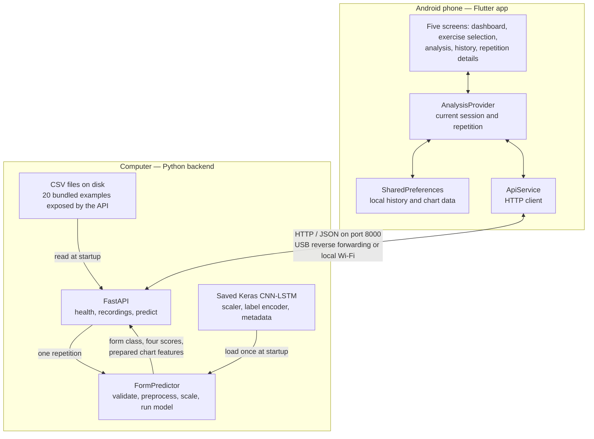

# Architecture

[Documentation index](README.md) · [Run on Android](android-quickstart.md) · [Inference and API](inference.md)

## The mental model

The **app** is the interface: it starts sessions, sends recordings and displays results. The **API** is the bridge between Flutter and Python. The **inference pipeline** prepares raw readings and runs the trained model. The **model files** are saved artifacts on the computer, not Dart code or part of the phone's runtime.

A repetition is one complete movement containing many timestamped readings. A session contains multiple analyzed repetitions. The app counts repetitions when analysis completes; it does not detect boundaries from a continuous live stream.

## Architecture diagram

The model stays on the computer when the app is installed on a phone. There is no cloud service, account system or backend history database. This diagram describes the implemented recording-based flow; live shoe connectivity is future work.

## A complete analysis request

1. The user starts a Bicep Curl session. Flutter requests `GET /recordings`, then downloads one repetition from `GET /recordings/{id}`. Importing JSON provides the repetition directly instead.
2. Flutter posts raw `imu` and `emg` streams and the exercise name to `POST /predict`. The known dataset label is not included in the model input.
3. FastAPI validates row sizes, finite values and input limits. Inference also checks increasing timestamps and overlapping streams.
4. Python calculates muscle RMS envelopes, aligns the streams, resamples the repetition to 256 steps and normalizes eight channels using the saved scaler.
5. The CNN-LSTM receives one example shaped `(1, 256, 8)` and returns four class scores. The API also returns the prepared, unnormalized features for charts.
6. Flutter displays the class, confidence, probabilities and charts. It retains the recording source and known dataset label separately.
7. On completion, Flutter saves the session and chart data locally. History reads these records and opens the existing repetition-detail screen.

With **Offline UI preview** on, `MockDataService` generates a repetition locally and skips the API/model. Mock results are labeled. This is a separate preview path, not a fallback that silently replaces failed inference.

## Repository map

Paths start at the cloned repository root.

| Location | Responsibility | Change it when… |
| --- | --- | --- |
| `workout_ai/lib/main.dart` | Entry point, providers and theme | Changing app-wide setup. |
| `workout_ai/lib/screens/` | Five existing screens | Changing layouts or screen interactions. |
| `workout_ai/lib/theme/app_theme.dart` | Colors, type scale, spacing and component theme | Adjusting the visual system. |
| `workout_ai/lib/widgets/` | Shared cards, controls and charts | Fixing a shared visual element. |
| `workout_ai/lib/services/analysis_provider.dart` | Sessions, API requests and history | Changing the session lifecycle. |
| `workout_ai/lib/services/api_service.dart` | HTTP calls and `API_BASE_URL` | Changing the API connection. |
| `workout_ai/lib/services/mock_data_service.dart` | Mock signals and predictions | Updating the offline UI preview. |
| `workout_ai/lib/models/workout_models.dart` | App data types and history serialization | Changing repetition/session representation. |
| `backend/app.py` | Routes, validation, example loading and startup | Changing an API operation. |
| `backend/inference.py` | Preprocessing and `FormPredictor.predict` | Changing model input preparation or inference. |
| `ML/model_outputs/` | Model, scaler, encoder and metadata | Replacing a validated set of artifacts. |
| `ML/synthetic_workout_dataset/data/raw/` | Raw IMU, EMG and labels | Inspecting source recordings. EMG uses Git LFS. |
| `ML/test.py` | CLI inference demonstration | Trying the model without Flutter. |
| `ML/train.py` | Original training pipeline | Intentionally retraining; not app startup. |
| `workout_ai/test/`, `backend/test_api.py` | App/layout and backend checks | Verifying changes; see [development](running.md#checks). |

## Boundaries that matter

- **UI changes** normally stay within Flutter screens, theme and widgets. They do not require retraining or preprocessing changes.
- **Model changes:** the model, scaler, encoder, feature order and metadata must stay compatible. Updating just one can make predictions incorrect. See [inference](inference.md).
- **Live sensors:** a device reader must assemble compatible streams and identify repetition start/end before calling the API. Wrist/EMG inputs cannot simply be replaced with shoe-only channels. See [hardware](hardware.md).
- **Deployment:** USB forwarding is a development connection. An independently usable phone still needs a reachable backend for real inference, or a future on-device model integration.

## Current verification

The backend and browser release build have been run. Six Flutter tests cover session behavior and phone-width layouts, including enlarged text, history labels, the EMG tab and a flat signal. Three backend tests cover real prediction, invalid input and preprocessing parity with training.

Native Android installation, launcher appearance and real sensor hardware still need device validation. The quick start describes the intended Android procedure without claiming those checks have already happened.
