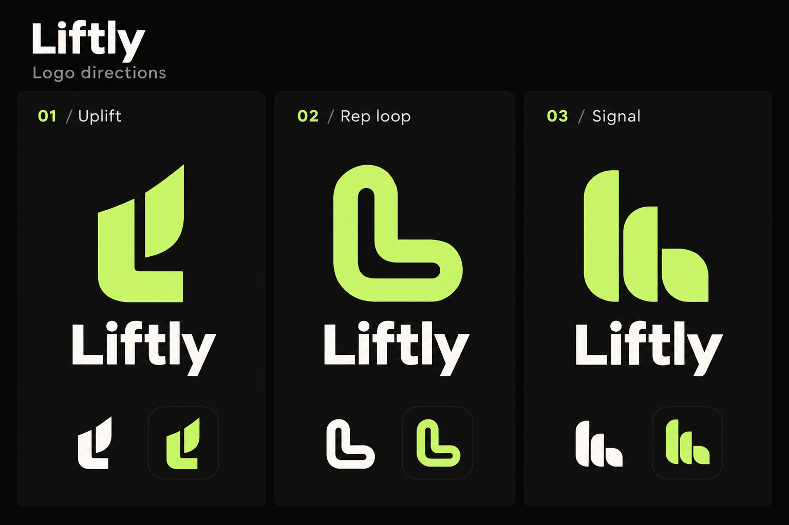

# Liftly

The owner selected **Liftly** as the app name. Display names are updated in Flutter, web, Android and iOS. Package identifiers and saved history keys stay unchanged so this naming change preserves app identity and existing sessions.



Logo concepts, generated with the built-in imagegen tool:

- **01 / Uplift — recommended:** an L with a rising stroke. The clearest connection to lifting and progress.
- **02 / Rep loop:** a rounded L loop suggesting repeated movement.
- **03 / Signal:** rounded segments connecting the brand to sensor data.

These are visual references. A final logo has not been selected or installed as the launcher icon. Name, domain and trademark availability have not been checked.

## Generation prompt

```text
Use case: logo-brand.
Asset type: one polished landscape brand exploration board with three columns for a workout form feedback app called Liftly.
Primary request: create three distinct, simple, catchy, professional logo concepts for Liftly, each easy to recognize as a small Android app icon. Use a precise flat vector-like graphic style with generous negative space and consistent clean layout.
Backdrop: near-black #080808, three subtly separated charcoal panels; restrained lime #C7F36B and warm white.
Composition: title "Liftly" at top left, small subtitle "Logo directions". Three equal columns labeled "01 / Uplift", "02 / Rep loop", "03 / Signal". Each column has a large original lime symbol, the exact wordmark "Liftly" below it in a confident friendly modern sans-serif with careful kerning, then a small white monochrome symbol and small dark app-icon preview near the bottom. All three directions share equal visual weight.
01 Uplift: a bold minimal geometric lowercase l mark whose terminal rises, evoking lifting and progress; simple distinctive silhouette, no generic arrow in a circle.
02 Rep loop: one continuous rounded ribbon forming a compact abstract L-shaped loop, evoking repeated movement; no infinity symbol.
03 Signal: three rounded connected segments rising in a subtle controlled motion, forming a compact L-like monogram; avoid medical ECG imagery.
Constraints: exact text spelling L-i-f-t-l-y, easy-to-read labels only, no additional prose or slogans. Each mark must be plausible as a one-color vector and legible at 24 pixels. Precise geometric shapes. No gradients, shadows, bevels, textures, photographic mockups, stock dumbbells, bodybuilders, brains, medical crosses, shoe illustrations, watermarks or borrowed brand logos. This is a concept board, not a screenshot of an app.
```
